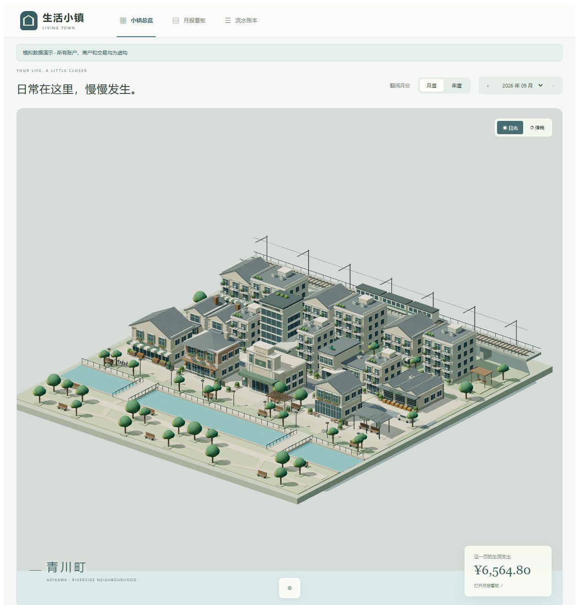
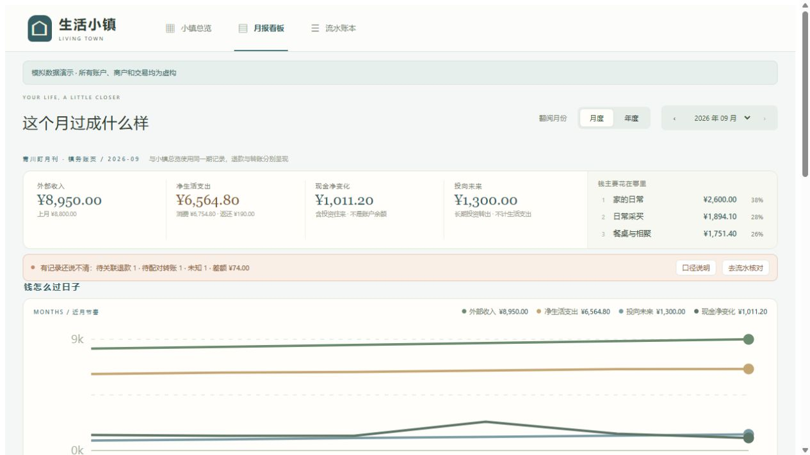

# 生活小镇 · Living Town

**把日常现金流，呈现为一座可以观看的微缩社区。**

[在线体验](https://tomnick777.github.io/living-town/) · [架构说明](docs/architecture.md) · [数据边界](docs/data-invariants.md)

生活小镇是一个已收尾的个人作品：Python / SQLite 保存财务事实，React / Three.js
把生活活动呈现在河岸街区。工资到账、咖啡到访、公交出行、包裹到家与住宅反馈
各有自己的表现，账本也可以回到月报和逐笔流水里查看。

**演示中所有账户、商户和交易均为全合成数据。无需登录，不连接个人账本。**



## 可以体验什么

- 3D 河岸街区：列车、公共空间、邻里人群与交易触发的活动；支持观看角度与日光/傍晚切换。
- 月度/年度小镇：切换六个月的合成生活与年度缩时重放。
- 月报看板：跨月节奏、生活日历、商户净支出与账户资金流。
- 流水账本：按交易类型、未决状态与关键词筛选，分页查看事实。
- 诚实的未决状态：未知交易、无主退款、单边转账都保留；不制造调整分录来平账。



## 本地运行

只看前端：

```bash
cd web
npm ci
npm run dev
```

打开终端显示的 `http://localhost:5173/`。默认是独立的合成演示，不需要 Python 服务。
部署构建：`npm run build`；查看构建结果：`npm run preview`。

复现账本与演示数据（Python 3.11+）：

```bash
pip install -e ".[dev]"
python scripts/build_demo.py --check
python -m pytest
```

`tests/fixtures/portfolio/` 的合成 CSV 会导入临时 SQLite，经过实际分类、转账/
退款处理和财务投影，生成 `web/public/demo/ledger.json`。`--check` 验证已提交
快照；去掉它可以重建。脚本自动销毁临时数据库，不接受用户数据库参数，也不调用外部服务。

前端验证：

```bash
cd web
npm test
npm run build
```

## 为什么这样设计

**事实、解释与表达分开。** 原始证据只追加，canonical ledger 使用整数分，
分类与能量解释可重算且带出处。转账、退款和投资分别处理，避免现金移动被误算成消费或收入。

**浏览器负责呈现。** 金额与看板来自 Python 投影，浏览器不读取 SQLite，也不
重新算账。公开演示与显式本机模式使用同一套 JSON 契约，连接失败不以模拟数据冒充真实数据。

**生活比消费分类更宽。** 小镇是固定社区，活动由数据驱动；人物路线是表达，
不是定位轨迹。建筑不产生交易，也不反向定义账本模型。

## 本机维护能力与边界

Python 核心保留微信、支付宝、通用 CSV 与命名银行适配器，幂等导入、分类、
退款/转账处理、CLI、增量迁移与 localhost 服务。源码与测试均可查看。
`life-energy --help` 提供本地操作说明；`?local` 显式读取本机 API，
`?workbench` 打开原 SVG 世界工作台。正式账本始终放用户本机。

项目已停止扩展功能。没有云账本、银行 API、预算系统或 AI 分类产品；年度月报/
流水按该年最后一个有数据的月份查看。3D 需要 WebGL；手机画面为紧凑展示，建议桌面体验。
跨项目 Evidence 桥接与事件契约保留为可选本地能力，历史迁移演练不在此公开仓库中。

## 发布与来源

GitHub Actions 验证 Python、前端与合成快照，并构建静态演示。GitHub Pages
只发布 `web/dist`，不会运行账本服务。见 [发布说明](docs/release.md) 与
[当前状态](PROJECT_STATE.md)。

设计曾参考 [all-wallet-manager](https://github.com/2402508251/all-wallet-manager)
的账单格式与对账思想；本仓库按三层模型与派生表达独立实现。
街区由程序几何生成，没有使用真实账单截图或外部 3D 模型。

MIT License · © 2026 TomNick777
