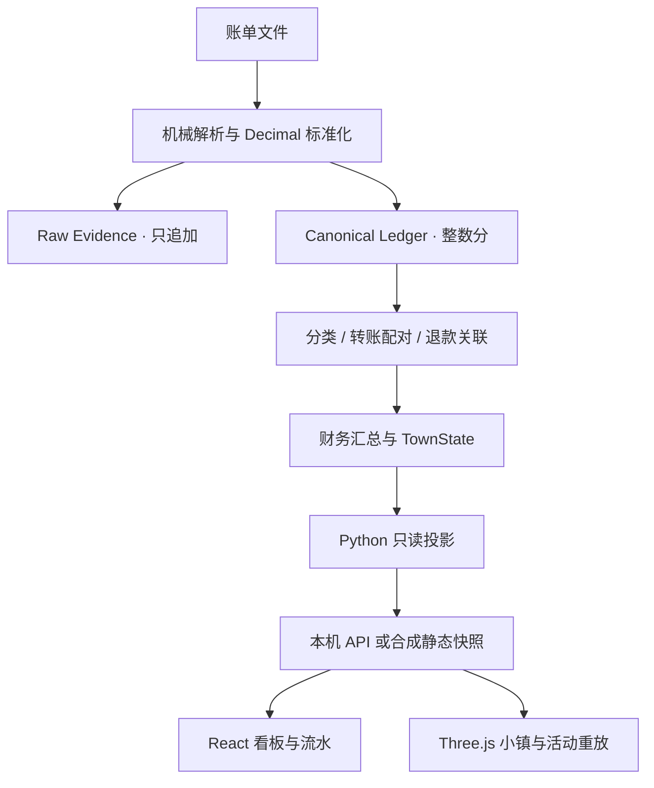

# 架构：事实有出处，表达有边界

SQLite 的三层模型分别保存原始证据、标准财务事实和可重算解释。
文件 hash 与行级指纹保证幂等。分类按人工覆盖、用户规则、商户、关键词、
启发式的优先级执行，每个自动结论保留规则与证据。

金额始终使用非负整数分，方向单独存储。内部流动为 TRANSFER，退款为 REFUND，
投资为 INVESTMENT；它们不被改记为生活消费或外部收入。对账失败保留差额与未决项。

TownState、TownPeriod、LedgerBoard、LedgerReview 都是财务数据的只读投影。
TownWorldState 独立保存本地工作台的建筑意图，不产生财务事实。
小镇不是“消费分类对应一栋楼”的账本模型；事件的地点与行为只是表达语义。

公开演示从全合成 CSV 经真实 Python 管线生成快照，前端只校验、展示和筛选。
流水筛选/分页不生成金额汇总；年度总览来自年度投影，看板与流水明确落到年内最后一个月。
`?local` 使用原本的 localhost HTTP 契约，连接失败时显示错误，绝不自动替换成合成数据。

活动重放使用预计算事件、道路图和有界人物池。出行、配送、到访、工资、
住宅反馈各有行为；没有定位数据，不声称还原真实行程。
街区用程序几何生成，昼夜开关仅是观看设置。

主要模块：`ingestion` / `normalization` / `ledger` / `classification` /
`reconciliation` / `energy` / `living_town` / `web`。
Evidence HTTP bridge 与 TownEvents v3 保留为可选本地契约；公开演示不连接它们。
试点 consumer、生产迁移演练、一次性修复脚本与私人运作记录已排除。

相关边界见 [data-invariants](data-invariants.md) 与 [ADR](decisions/README.md)。
